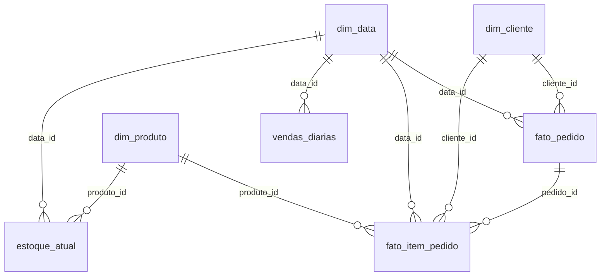

# Gold de vendas e ultimo saldo de estoque

A Gold transforma um snapshot validado da Silver em sete tabelas Parquet no MinIO. E uma carga em lote, executada depois da Silver, e uma evolucao adicional ao MVP de ingestao. Nao implementa autorizacao de pagamento, chamadas aos fornecedores nem um DW em outro banco.

## Modelo e graos

| Tabela | Uma linha representa | Chave |
|---|---|---|
| `dim_cliente` | Cadastro atual de um cliente, incluindo cadastros excluidos ainda conhecidos | `cliente_id` |
| `dim_produto` | Cadastro atual de um produto, incluindo cadastros excluidos ainda conhecidos | `produto_id` |
| `dim_data` | Um dia do calendario entre as datas presentes nos fatos | `data_id` = AAAAMMDD |
| `fato_pedido` | Um pedido ativo na Silver, com seu estado atual | `pedido_id` |
| `fato_item_pedido` | Uma linha ativa de item de um pedido ativo | `pedido_id`, `numero_linha` |
| `vendas_diarias` | Resumo por dia, status, moeda e indicador de simulacao | `data_id`, `status`, `moeda`, `is_simulated` |
| `estoque_atual` | Ultimo saldo observado de um produto em um deposito | `produto_id`, `deposito_id` |



As dimensoes usam as chaves de negocio da Silver e o cadastro atual (tipo 1); nao ha SCD tipo 2. Cada snapshot preserva a versao completa usada naquela publicacao. `numero_linha` continua sendo a posicao do item no pedido, conforme o contrato Silver.

## Indicadores e regras

- `quantidade_pedidos`: contagem de linhas da `fato_pedido`, sem juntar os itens antes de contar.
- `valor_pedidos`: soma de `valor_pedido`, uma unica vez por pedido.
- `quantidade_unidades`: soma das quantidades dos itens, diferente da quantidade de linhas.
- `ticket_medio`: `valor_pedidos / quantidade_pedidos`, arredondado em duas casas com HALF_UP.
- O valor do pedido existe somente em `fato_pedido`. Em `fato_item_pedido`, `valor_item = quantidade * valor_unitario`; somar o total do pedido depois de uma juncao com os itens duplicaria valores.
- Status sao preservados e separados. `APPROVED`, `PENDING`, `CANCELED` ou outros estados nao sao traduzidos para pagamento recebido. Para analisar apenas aprovados, filtre o status explicitamente.
- Os valores sao valores de pedidos, nao receita recebida ou lucro. A Gold nao depende dos pagamentos ficticios para calcular vendas.
- Moedas e `is_simulated` nunca sao misturados no mesmo agregado. O indicador de simulacao e o da Silver: `false` nao comprova uma transacao real, pois o simulador de checkout tambem escreve pela origem CDC.
- O dia comercial usa `America/Sao_Paulo`; timestamps e observacoes continuam em UTC. `GOLD_TIMEZONE` pode mudar o fuso e gera outro snapshot. O dia de venda e o da criacao do pedido, nao o horario de chegada do CDC.
- A carga representa o estado atual dos pedidos. Uma alteracao de status reclassifica o pedido no seu dia de criacao; uma exclusao retira seus fatos e itens da nova Gold, mantendo snapshots anteriores e os eventos brutos.
- `estoque_atual` usa somente `inventory` da Silver: saldo fisico e virtual por deposito, com `observado_em`. Nao soma o estoque do PostgreSQL ao do Bling, nao calcula reservas e nao garante atualizacao em tempo real.

## Qualidade e rastreabilidade

Cadastros ausentes geram uma linha de dimensao com o ID original e `is_unknown=true`, preservando os fatos. Cadastros excluidos continuam nas dimensoes com `is_deleted=true`. Pedidos sem nenhum detalhe de item continuam nos indicadores de pedidos e recebem a flag `order_without_items`; quando existem itens, seus valores precisam reconciliar integralmente com o pedido.

Chaves duplicadas, relacionamentos invalidos entre fatos, divergencia entre total e itens e inconsistencias dos agregados bloqueiam a publicacao. Rejeicoes de modelagem ficam em `gold/quarantine/`. Corrupcao de arquivos ou falha de escrita tambem impedem trocar `LATEST.json`, preservando a ultima Gold publicada.

O manifesto registra `silver_snapshot_id`, hash do manifesto Silver, hash do codigo, fuso, contagens, checksums e indicadores de qualidade. A validacao relê os Parquets, confere schemas, chaves e relacionamentos, recalcula os indicadores e reconcilia pedidos, itens e saldos com a Silver de origem. A Gold nao modifica objetos Bronze ou Silver.

```text
gold/LATEST.json
gold/snapshots/<snapshot_id>/manifest.json
gold/snapshots/<snapshot_id>/dim_cliente/part-00000.parquet
gold/snapshots/<snapshot_id>/dim_produto/part-00000.parquet
gold/snapshots/<snapshot_id>/dim_data/part-00000.parquet
gold/snapshots/<snapshot_id>/fato_pedido/part-00000.parquet
gold/snapshots/<snapshot_id>/fato_item_pedido/part-00000.parquet
gold/snapshots/<snapshot_id>/vendas_diarias/part-00000.parquet
gold/snapshots/<snapshot_id>/estoque_atual/part-00000.parquet
```

O snapshot e identificado pelo conteudo e pelo modelo. Repetir a mesma carga reutiliza os arquivos validados; mudar o snapshot Silver, o codigo ou o fuso cria uma nova versao. Para consultar varias tabelas, leia `LATEST.json` uma vez e use o manifesto apontado para todas elas. Nao una snapshots completos de dias diferentes como se fossem particoes incrementais: isso repetiria os pedidos.

## Executar

Com o Compose ativo e uma Silver publicada:

```powershell
docker compose exec -T airflow python -m pipelines.cli build-gold
docker compose exec -T airflow python -m pipelines.cli verify-gold
```

Para atualizar as duas camadas em sequencia:

```powershell
docker compose exec -T airflow python -m pipelines.cli build
docker compose exec -T airflow python -m pipelines.cli build-gold
docker compose exec -T airflow python -m pipelines.cli verify-gold
```

Para construir a Gold de uma Silver especifica, use `build-gold --silver-snapshot <id>`. O comando `demo` prepara os exemplos conforme as regras atuais, gera Silver e Gold em sequencia. `start-shopvibe.ps1` tambem valida a Gold ao concluir a demonstracao.

A DAG existente `shopvibe_silver_diaria`, as 02:00 UTC, executa `build_silver -> validate_silver -> build_gold -> validate_gold`. A task Gold recebe o ID exato produzido pela task Silver da mesma execucao. O nome da DAG foi mantido por compatibilidade. Para executar pelo Airflow, dispare essa DAG e confira as quatro tasks.

Os testes em `tests/test_gold.py` cobrem graos e valores, dia comercial, separacao de moedas/status/simulacao, exclusoes, dimensoes ausentes, detalhes incompletos, reprocessamento, origem fixada por snapshot, falhas parciais, corrupcao e divergencia de agregados mesmo com checksums consistentes.
